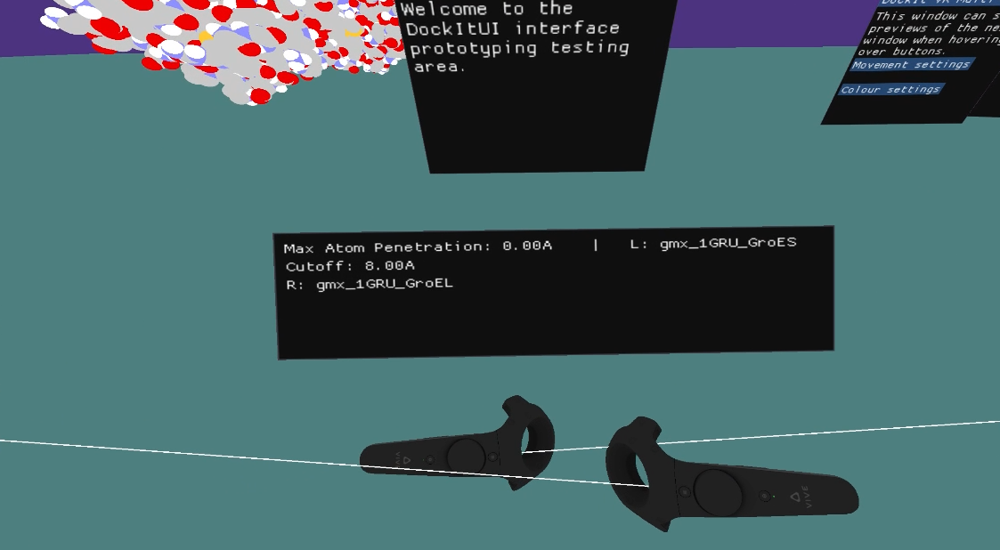
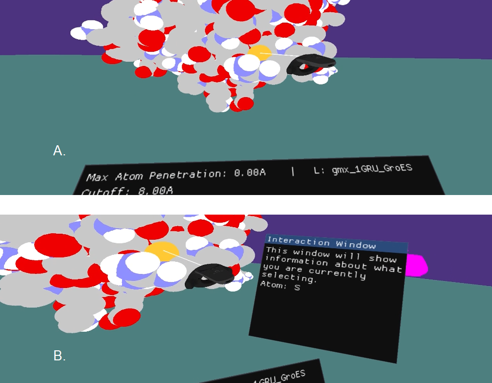
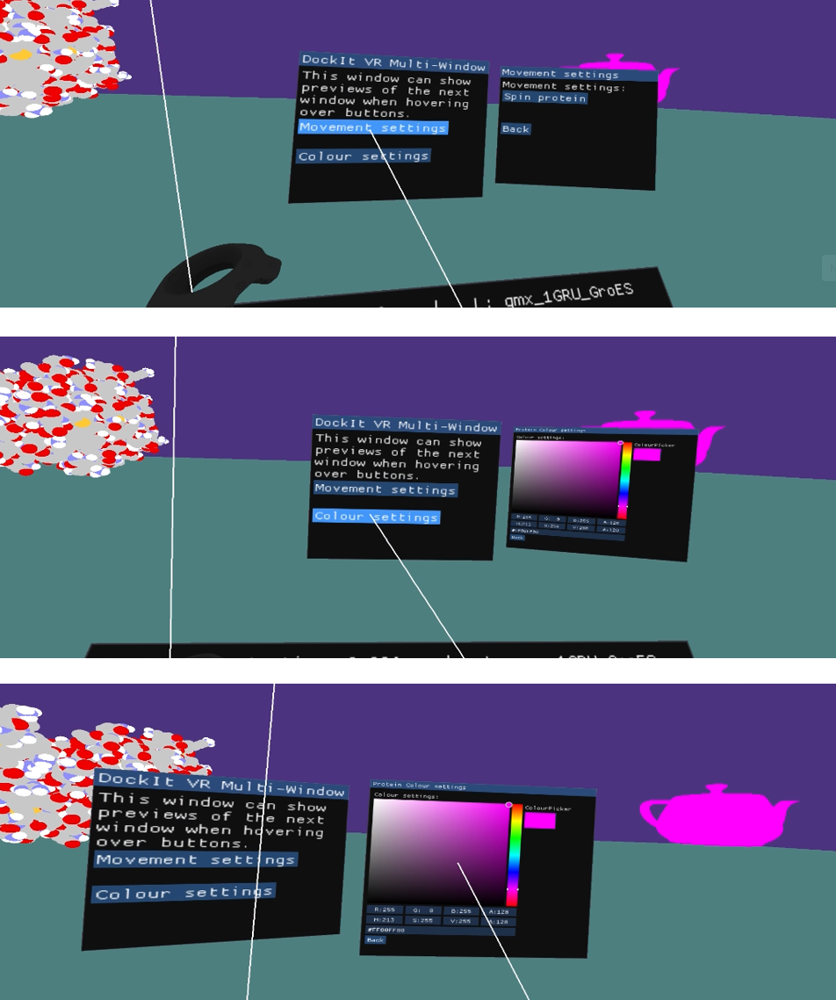
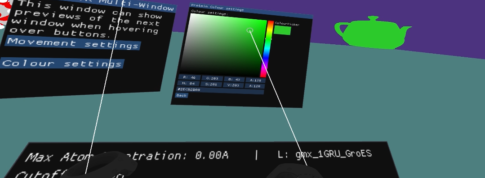
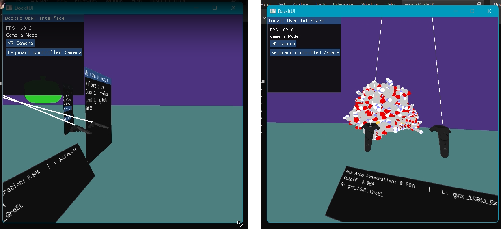

# VREngine

VR interfaces for DockIT. This is the project Will Bosley and I did for our MComp at the University of East Anglia in
2022–2023, supervised by Dr Stephen Laycock and Dr Steven Hayward. It's a VR program written in
C++ and OpenGL that runs on a range of headsets through OpenVR, with prototype user interfaces for
DockIT, a tool for simulating molecular docking.

This is my copy of the project, with the full commit history. The original repo, where Will and I
worked on it, is [wbosley/MComp](https://github.com/wbosley/MComp).



## Background

DockIT can already be used in VR, but only on Oculus headsets, and its VR interface only has a
small part of the controls from the desktop version. The aims of our project were to:

- write a VR program in C++ that runs on a range of headset brands, not just Oculus
- make a prototype VR user interface, showing what interfaces in future versions of DockIT could
  be like

It isn't meant to recreate DockIT's functionality. It's a "playground" scene with example windows
and menus, an example protein, and a teapot.

## What it does

**Selecting atoms.** You point the ray from your controller at an atom and press the interact
button. A window appears telling you what the atom is. In the screenshot the yellow atom has been
selected and the window says it's sulfur.



**Menu previews.** When you hover over a button that leads to a sub-menu, a preview of that menu
appears to the right. Selecting it makes it the main window and pushes the previous one aside, so
you can always see where you came from. We copied this idea from Half-Life: Alyx after seeing how
well people got on with it in our user research.



**Colour picker.** An ImGui colour picker that works in VR, here used to change the teapot's
colour. In DockIT this would be used for changing the colour of atoms.



**Status bar.** A bar at waist height that follows you around, showing example status text like
DockIT's max atom penetration and cutoff. It's in the same place as the status bar at the bottom
of DockIT desktop, and it's based on the Oculus Dash taskbar.

**Movable windows.** You drag a window by pointing at the bar at the top and holding interact, like
moving a window on Windows. Windows keep facing your controller's ray while you move them.

**Desktop view.** The program also opens a normal window on the monitor, with a keyboard and mouse
camera, or the view from the headset. The idea is that a teacher could show a class what the
person in the headset is doing.



It was tested with an HTC Vive and an Oculus Rift S, which were the two headsets we had. Between
them, their controller layouts match six other headsets, which covered 73.46% of the headsets used
on SteamVR in April 2023.

## How it works

The full write-up is in the project report. This is the part about the engine.

### Choosing OpenVR

We looked at OpenXR and OpenVR. OpenXR supports more platforms, but its documentation was very
difficult to understand and none of the sample code we downloaded would build or run. OpenVR had a
wiki and working samples, so with an 8 month timescale we picked OpenVR. It runs through SteamVR,
so it works with Valve, HTC and Oculus headsets.

The rest of the libraries are OpenGL with GLEW, GLFW for the desktop window, GLM for the maths, and
Dear ImGui for the interfaces.

### Matrices

Every object has a model matrix that places it in the world. To move around, the world does the
opposite of the camera: the view matrix is the inverse of the camera's transformation matrix. Then
a projection matrix applies perspective, so the final transform is `Projection * View * Model`.

For VR, OpenVR gives the view matrix for the centre of the headset and the offset of each eye from
it, and the projection matrix for each eye. The headset and controller matrices are then combined
with our own camera matrix, so you can move around the world with the left stick and the
controllers follow you.

### Rendering to the headset

`VRLoader::initVR` checks a headset is connected and that the OpenVR runtime is installed, loads
the compositor, reads the controller bindings from the action manifest JSON files, and gets the
render size and projection and view matrices for each eye.

Each frame, `refresh` gets the pose of every device (a 4x4 matrix that puts it in the right place
in the world), and `handleInput` reads the buttons and stick and works out where the controllers
are and which controller model to draw. The scene is then rendered once per eye into that eye's
own framebuffer, and both textures are submitted to the compositor, which puts them on the
headset's screens.

### Proteins

Proteins are loaded from PDB files. `ProteinLoader` reads every line starting with `ATOM` and gets
the atom's name and X, Y and Z coordinates. At first we split the lines on whitespace, but PDB
files only look like they're delimited by whitespace. The meaning of each character comes from its
position in the line, so if a value fills its whole column there's nothing between it and the next
one. We switched to reading fixed substrings.

Each atom gets its van der Waals radius and CPK colour from data tables, and `Protein3D` turns each
atom into a sphere. Originally every sphere was its own `Model3D`, so a protein with N atoms went
through the whole VBO/VAO setup and draw N times, which was very slow. `Model3D::addModelToMesh`
combines all the spheres into one mesh, so the whole protein is drawn once.

### ImGui windows in 3D

ImGui is made for drawing 2D interfaces over the top of a window. The breakthrough was finding out
that when `ImGui_ImplOpenGL3_RenderDrawData` is called, it draws into whatever framebuffer is
bound. So each window in the world (`ImGui3D`) has:

- its own ImGui context, so each window can be handled separately. Switching context is like
  binding in OpenGL.
- its own framebuffer with an empty texture the size of the window
- a quad (two triangles) that uses that texture

Each frame, `GuiLoader::renderVRGui` binds each window's context, fills in its widgets, renders
ImGui into its framebuffer, and then draws the quad in the world like any other model.

### Pointing at things

The ray from a controller is a line between the controller's position and a point a set distance
in front of it. To check if it hits a window, each triangle of the window's quad goes into
`glm::intersectRayTriangle`, which uses the Möller–Trumbore algorithm and gives back the distance
along the ray. The hit point is

```
pt = rayStart + distance * rayDir
```

That point is transformed back into the quad's own space with the inverse of its model matrix.
The quad is 1 unit wide and centred on 0,0,0, so the position on the ImGui window is

```
x = w * (0.5 + pt.x * 0.5)
y = h - w * (0.5 * pt.y + 0.5)
```

where `w` and `h` are the window's width and height. That position is given to ImGui as the mouse
position, and the interact button as a click.

For atoms, the ray is first checked against an invisible bounding box around the protein, so it
doesn't test every atom when you're not even pointing at it. If it hits, the ray is checked
against the protein's triangles. All the spheres have the same number of triangles and are stored
in the same order as the atoms, so dividing the index of the hit triangle by the triangles per
sphere gives the index of the atom.

## What it added over my earlier engine

Before this I wrote [JavaGEngine](https://github.com/gpbeales/JavaGEngine), a software renderer
where I worked out every pixel myself. A lot of the ideas carried over, but the way they're done
changed:

- **Rasterization.** In Java I filled triangles with edge functions and my own Z-buffer on the
  CPU. Here OpenGL does that on the GPU, and the work moves to getting data into VBOs and VAOs and
  writing shaders.
- **Matrices.** I wrote my own `Mat4x4` class in Java. Here GLM does the maths.
- **Perspective.** I couldn't get the projection matrix working in Java and used a perspective
  divide instead. Here the desktop camera uses `glm::perspective`, and OpenVR gives a projection
  matrix for each eye.
- **Moving around.** In Java I moved every triangle in the opposite direction to the way you were
  going. That's the same idea as a view matrix, but now it's done properly as the inverse of a
  camera matrix.
- **Loading models.** The OBJ loader in Java was an empty class. Here `OBJLoader` reads OBJ files
  and `ProteinLoader` reads PDB files.
- **New things.** Rendering to a texture with framebuffers, rendering twice for two eyes,
  batching thousands of spheres into one draw call, and ray picking. Ray-triangle intersection
  uses barycentric coordinates again, but for working out what you're pointing at instead of
  filling in pixels.

## Research

Before writing the interface we ran think-aloud tests and System Usability Scale surveys with four
participants, with UEA ethics approval. They tried the menus in Half-Life: Alyx, the molecular
modelling tool Nanome, and Oculus Dash. What we took from it:

- People found floating menu windows, operated by pointing a ray, easy to use.
- Half-Life: Alyx's menu previews were the favourite, with the highest SUS score of 85.6.
- Everyone disliked Nanome's way of selecting parts of a molecule from a menu (SUS 53.1). Every
  participant tried to point at the molecule first, so in our version you point at atoms.
- People liked the Oculus Dash taskbar, which is where the status bar came from.

## Building and running

You need Windows, Visual Studio, SteamVR, and a VR headset.

1. A few binaries aren't in the repo, because the `.gitignore` drops `Release` and `bin` folders:
   - GLEW: download the Windows binaries from [glew.sourceforge.net](https://glew.sourceforge.net/)
     and extract them into `DockItUI/libraries/glew`, so that `lib/Release/x64/glew32.lib` and
     `bin/Release/x64/glew32.dll` exist.
   - OpenVR: get `bin/win64/openvr_api.dll` from
     [OpenVR v1.23.7](https://github.com/ValveSoftware/openvr/tree/v1.23.7), which matches the
     headers in the repo.
2. Open `DockItUI/DockItUI.sln` in Visual Studio and use the Debug x64 configuration.
3. In Project > DockItUI Properties > Configuration Properties > Debugging > Environment, add
   `SolutionDir=$(SolutionDir)`. The program uses it to find the controller binding files.
4. Build, then copy `glew32.dll` and `openvr_api.dll` next to `DockItUI.exe` in `x64/Debug`.
5. Run it in the Local Windows Debugger with the headset connected and SteamVR running.

### Controls

| Input | Action |
| --- | --- |
| Point and pull the trigger | Select an atom, press a button, or drag a window by its top bar |
| Left stick / trackpad | Move around |
| W A S D | Move the desktop camera |
| Hold right click and move the mouse | Rotate the desktop camera |

## Code layout

```
DockItUI/src
├── DockItUI.cpp        main, init, the render loop, and ray intersection checks
├── VRLoader            headset and controller setup, poses, input, rendering to each eye
├── GUILoader           creates and renders all the ImGui windows
├── ImGui3D             one ImGui window in 3D: context, framebuffer and quad
├── FrameBuffer         creates framebuffers with colour and depth attachments
├── Model3D             geometry, VBOs/VAOs, quads, lines, OpenVR controller models, mesh merging
├── Protein3D           a protein as one merged mesh of spheres
├── ProteinLoader       reads PDB files
├── Sphere              generates the sphere for one atom
├── OBJLoader           reads OBJ files
├── Camera              the keyboard and mouse desktop camera
├── Shader              loads vertex and fragment shaders from one file
├── DataTable           van der Waals radii and CPK colours
├── models/ proteins/ shaders/
└── hellovr_*.json      the action manifest and controller bindings
```

Valve's OpenVR sample, `hellovr_opengl`, is a single 2000+ line file, which made it hard to learn
from. We split everything into classes with names that say what they do, so it would be easier for
DockIT's developers to take parts of it.

## Limitations

- **Memory.** New memory gets allocated every frame instead of reusing the previous frame's. We
  prioritised getting the features done over fixing it.
- **Window scaling.** The windows started at 200x200, which was too small for the colour picker.
  We changed them to 400x400 and then had to scale the font differently per window to keep the
  text readable in VR.
- **Controllers.** Only Oculus Touch and Vive wand bindings are set up. With an Index we could have
  added a third set of bindings and covered about 90% of headsets.
- **Testing.** We didn't get to run user testing on the finished program, because ethics
  applications take at least 10 days and the program was still being developed until close to the
  deadline.

## Licences

OpenVR, GLM, GLFW, GLEW and Dear ImGui are under their own licences, which are collected in
[DockItUI/LICENSES.txt](DockItUI/LICENSES.txt).
